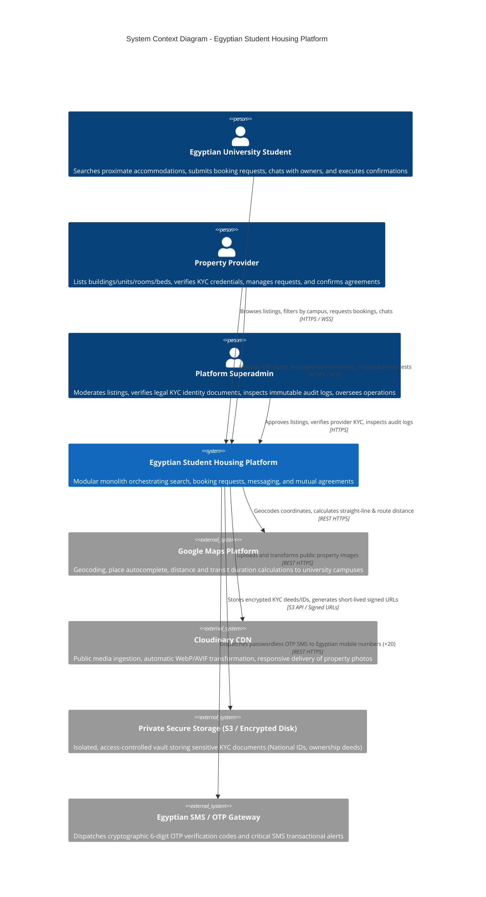
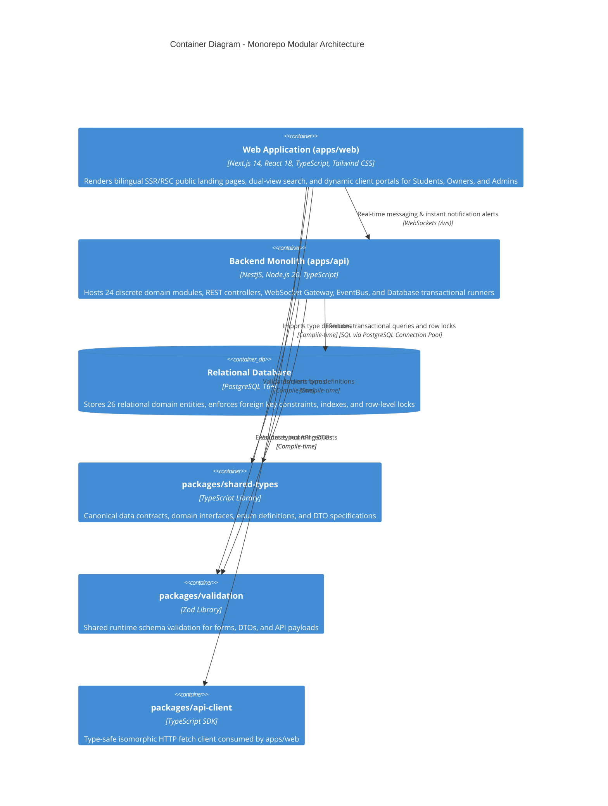
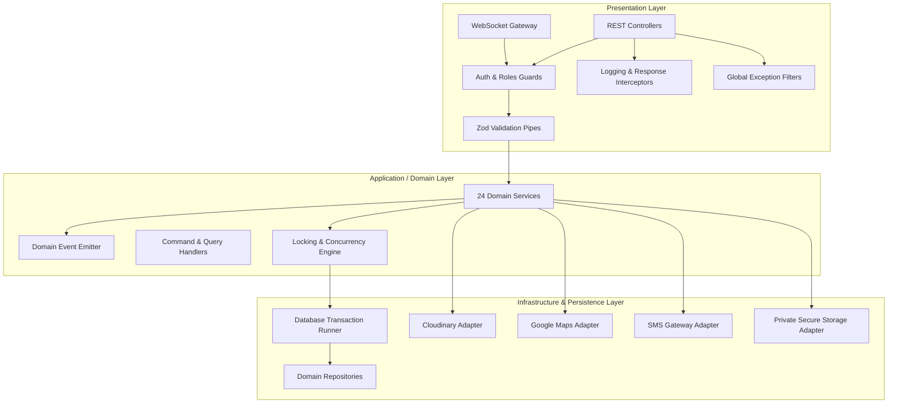

# Egyptian Student Housing Platform — System Architecture Specification

**Document ID**: `ARCH-SYS-001`  
**Version**: `1.0.0` (Phase 2 System Architecture)  
**Status**: `Approved Standard`  
**Target Monorepo**: `student-housing-platform/` (per `app2.txt`)  
**Architectural Decision Records**: `ADR-001` (Modular Monolith), `ADR-002` (Next.js App Router), `ADR-003` (NestJS Backend), `ADR-004` (PostgreSQL)

---

## 1. Architectural Mission & Paradigm

### 1.1 Executive Summary

The Egyptian Student Housing Platform (**منصة سكن الطلاب في مصر**) is engineered as a **TypeScript Monorepo Modular Monolith**. The platform centralizes discovery, verified listings, transparent student-provider communication, and legally binding mutual agreement confirmations across Egyptian university hubs (e.g., Cairo, Giza, Alexandria, Mansoura, Assiut).

To satisfy the requirements defined in `app.txt` (§6, §7, §8, §10) and `app2.txt`:

1. **Monorepo Structure**: Governed by npm workspaces and TypeScript project references, housing two unified applications (`apps/web` and `apps/api`) and four shared libraries (`packages/shared-types`, `packages/shared-config`, `packages/api-client`, `packages/validation`).
2. **Modular Monolith Paradigm**: A strictly structured in-process modular backend using NestJS. Microservices are explicitly prohibited for MVP to avoid distributed data inconsistencies, dual-phase commits (2PC), and network latency during critical booking transactions.
3. **Relational ACID Consistency**: Powered by PostgreSQL 16, utilizing pessimistic row-level locking (`SELECT ... FOR UPDATE`) within isolated serializable transactions to guarantee that accommodation portions (units, rooms, beds) can never be double-booked.
4. **Bilingual RTL/LTR Presentation**: Built on Next.js 14 App Router, providing server-rendered, SEO-optimized public pages and highly reactive role-based dashboards with native Egyptian Arabic (`ar`, RTL) and English (`en`, LTR) support.

---

## 2. C4 Architectural Model

### 2.1 C4 Level 1: System Context Diagram

The System Context Diagram illustrates how the Egyptian Student Housing Platform sits within its operational environment, interacting with key human actors and external cloud services.



---

### 2.2 C4 Level 2: Container Diagram

The Container Diagram illustrates the high-level technical building blocks of the monorepo, detailing data protocols and compilation dependencies.



---

### 2.3 C4 Level 3: Component Diagram (Backend Monolith Layering)

Within `apps/api`, every domain request flows through a clean, multi-layered architectural boundary:



---

## 3. Modular Monolith Architecture & Module Boundary Rules

### 3.1 Monorepo Workspace Topology

The project follows the canonical layout dictated by `app2.txt`:

```
student-housing-platform/
├── apps/
│   ├── web/                     # Next.js App Router (Frontend)
│   └── api/                     # NestJS Modular Monolith (Backend)
├── packages/
│   ├── shared-types/            # Canonical TypeScript interfaces & enums
│   ├── shared-config/           # Unified ESLint, Prettier, TS configs
│   ├── api-client/              # Strongly-typed isomorphic HTTP client SDK
│   └── validation/              # Zod validation schemas
├── infrastructure/
│   ├── docker/                  # Dockerfile.web, Dockerfile.api, docker-compose.yml
│   ├── deployment/              # Environment manifests (dev, staging, prod)
│   ├── database/backup/         # Automated pg_dump backup routines
│   └── monitoring/              # Health & logging configs
└── docs/                        # Complete technical documentation
```

### 3.2 Strict Module Boundary Enforcement

To maintain architectural purity and prevent the modular monolith from degenerating into a tangled codebase, the following boundary rules are strictly enforced:

1. **Zero Direct Cross-Module Repository Access**:
   - `ModuleA` must **never** import or inject `Repository<EntityB>` owned by `ModuleB`.
   - All cross-domain access must occur via `ModuleBService` exported by `ModuleB` through NestJS Dependency Injection.
2. **Autonomous Domain Encapsulation**:
   - Each of the 24 backend modules owns its controllers, internal entities, DTOs, domain service, and specialized unit tests.
3. **Decoupled Asynchronous Side Effects**:
   - Side effects that are non-critical to the immediate database transaction (e.g., sending SMS alerts, updating search caches, logging platform analytics) are decoupled using `@nestjs/event-emitter`.
4. **Explicit Multi-Entity Transaction Runners**:
   - When an operation requires transactional mutation across multiple domains (such as executing an Agreement Confirmation), the orchestrating service (`AgreementsService`) initiates an explicit database transaction runner (`DataSource.transaction()`) using pessimistic locking.

---

## 4. Communication Patterns

### 4.1 Synchronous REST API Design

All synchronous client-server communication between `apps/web` and `apps/api` uses standard RESTful principles over HTTPS under `/api/v1/*`.

#### Standard Success Response Envelope

Every successful response returns an HTTP 2xx status code and adheres to the canonical `ApiResponse<T>` interface:

```typescript
export interface ApiResponse<T> {
  success: true;
  data: T;
  message?: string;
  meta?: {
    page?: number;
    limit?: number;
    total?: number;
    totalPages?: number;
  };
  timestamp: string; // ISO 8601 UTC
}
```

#### Standard Error Response Envelope

Every application exception intercepted by the `GlobalExceptionFilter` returns a standardized JSON structure:

```typescript
export interface ApiErrorResponse {
  success: false;
  statusCode: number;
  error: string;
  message: string;
  errors?: Array<{
    field?: string;
    message: string;
    code?: string;
  }>;
  timestamp: string; // ISO 8601 UTC
  path: string;
}
```

### 4.2 Asynchronous Domain Event Bus

In-memory domain events are dispatched via `@nestjs/event-emitter` (`EventEmitter2`). This pattern decouples transactional command execution from notification delivery, analytics logging, and background cache warming.

#### Canonical Domain Event Pipeline:

```
[User Action: Confirm Agreement]
        │
        ▼
[AgreementsService (DB Transaction Commit)]
        │
        ├── 1. Pessimistic Lock (`SELECT ... FOR UPDATE`)
        ├── 2. Verify Single Confirmed Booking Rule
        ├── 3. Update Status to CONFIRMED
        ├── 4. Set Availability to BOOKED
        ├── 5. Auto-close Competing Requests
        └── [Transaction Committed]
        │
        ▼ (emit 'booking.confirmed')
[EventBus / EventEmitter2]
        │
        ├──► [NotificationsListener] ──► Dispatches In-App & SMS Alerts
        ├──► [MessagingListener]     ──► Injects System Message into Chat Thread
        └──► [AnalyticsListener]     ──► Records Governorate Supply/Demand Metric
```

### 4.3 Real-Time Bidirectional WebSockets

The platform provides real-time bidirectional communication via NestJS WebSocket Gateway mounted at `/ws` using Socket.IO:

- **Authentication**: Clients perform initial WebSocket handshake using `Authorization: Bearer <jwt_token>`.
- **Rooms**:
  - `user:${userId}`: Personal notifications and status alerts.
  - `conversation:${conversationId}`: Dedicated chat channel for active booking requests.
- **Fallbacks**: Automatic long-polling fallback for constrained Egyptian mobile networks.

---

## 5. External Integration Boundaries

### 5.1 Cloudinary CDN (Public Media Ingestion)

- **Scope**: Exclusively used for public property photos, unit photos, floor plans, and room pictures.
- **Security Boundary**: Public CDN media. Zero PII or verification identity documents may be uploaded to Cloudinary.
- **Workflow**:
  1. Frontend requests a signed upload signature from `/api/v1/properties/upload-signature`.
  2. Backend signs the request using Cloudinary API Secret with strict transformation parameters (max 2048x2048, quality auto, format auto).
  3. Frontend uploads directly to Cloudinary CDN, receiving secure public URL and asset public ID.
  4. Backend persists the image metadata into the `PropertyImage` entity.

### 5.2 Google Maps Platform (Spatial Discovery & Proximity)

- **Scope**: Address geocoding, interactive map rendering, place autocomplete, and distance calculation to Egyptian university campuses.
- **Implementation**:
  - **Server-Side**: Google Maps Geocoding API converts Egyptian street addresses to latitude/longitude coordinates upon property creation.
  - **Distance Calculation**: The platform calculates the straight-line Haversine distance and driving/transit distance to the main campus coordinates of the target university (e.g. Cairo University Main Campus: `30.0276° N, 31.2089° E`).
  - **Client-Side**: Google Maps JavaScript SDK renders property markers, campus boundaries, and interactive cluster views.

### 5.3 Private Secure Storage (KYC Verification Documents)

- **Scope**: Strictly isolated storage for confidential property provider KYC documents (Egyptian National ID cards, property ownership deeds, registered power of attorney documents).
- **Security Boundary**: **Confidential PII Isolation**. Completely decoupled from public CDN.
- **Storage Strategy**: S3-compatible object store (e.g., AWS S3 with SSE-KMS encryption or an encrypted private filesystem mount).
- **Access Control**:
  - Zero public bucket read permissions.
  - Documents can only be retrieved by platform superadmins or the uploading owner.
  - Backend issues time-limited pre-signed download URLs with a 5-minute TTL, verified by `KycDocumentGuard`.
  - Under no circumstances are KYC documents shared with students or exposed in property/booking API responses.

### 5.4 Pluggable SMS / OTP Gateway

- **Scope**: Delivery of 6-digit passwordless authentication codes and critical transactional notifications to Egyptian mobile numbers (+20).
- **Interface Abstraction**: `SmsGatewayService` interface enables zero-cost local development (in-memory logger), staging sandbox, and seamless binding to Egyptian telecom SMS providers (e.g. VictoryLink, Twilio, or Infobip) in production.
- **Rate Limiting**: Hard-capped at 3 SMS dispatches per 15-minute window per phone number / IP address.

---

## 6. Architectural Reliability & Fault Tolerance

1. **State Machine Validation**: All booking requests, agreement confirmations, and listing moderation statuses are governed by formal finite state machines. Invalid state transitions throw immediate HTTP 400 `BadRequestException`.
2. **Idempotency**: All mutation endpoints (booking requests, confirmations, payments/expenses) support `X-Idempotency-Key` headers to prevent duplicate executions from mobile network retries.
3. **Database Health & Circuit Breaking**: The API integrates NestJS Terminus health indicators for database connection pooling, memory thresholds, and disk storage capacity.
4. **Graceful Shutdown**: On `SIGTERM` / `SIGINT`, the NestJS process ceases accepting new HTTP connections, allows active transactions up to 10 seconds to commit, and drains database connection pools cleanly.
