# Entity-Relationship Diagram & Database Architecture (ERD)

- **Platform**: Sakany Student Housing Platform (منصة سكن الطلاب)
- **Specification Document**: Phase 3 Technical Design & Database Architecture
- **Document Path**: `docs/database/erd.md`
- **Target Engine**: PostgreSQL 16+
- **Integrity & Design Baseline**: Aligned with `app.txt` (§5, §8) & `ADR-004-database-postgresql.md`

---

## 1. Executive Summary & Domain Aggregates

The platform database architecture is designed as a highly normalized, relational system implemented in PostgreSQL 16+. It models 26 distinct entities grouped into six cohesive domain aggregates that enforce strict student housing business rules, transactional safety, bilateral agreement confirmation, and immutable administrative auditing.

```
+--------------------------------------------------------------------------------------------------+
|                                    PLATFORM DOMAIN AGGREGATES                                    |
+--------------------------------------------------------------------------------------------------+
| 1. Identity & User Access       | Users, Student Profiles, Provider Profiles, Verifications      |
| 2. Geography & Academic Core    | Cities, Areas, Universities                                     |
| 3. Accommodation Inventory      | Properties, Images, Units, Rooms, Beds, Pricing, Expenses, Avail|
| 4. Booking & Legal Agreements   | Booking Requests, Agreement Confirmations, Agreement Documents  |
| 5. Communication & Trust        | Conversations, Messages, Notifications, Reviews, Responses, Reps|
| 6. Governance & Platform Audit  | Admin Action Logs, Platform Settings                            |
+--------------------------------------------------------------------------------------------------+
```

### Domain Aggregate Boundaries:

1. **Identity & User Access Domain**:
   - `User`: System-wide authentication entity, phone (+20 format), optional email, role (`STUDENT`, `OWNER`, `ADMIN`), status (`ACTIVE`, `SUSPENDED`, `DEACTIVATED`).
   - `StudentProfile`: 1:1 extension of `User` for students; full name, university ID, faculty, academic year, gender (`MALE`, `FEMALE`), optional enrollment document URL.
   - `PropertyProviderProfile`: 1:1 extension of `User` for property providers; provider type (`INDIVIDUAL_OWNER`, `AUTHORIZED_AGENT`, `MANAGEMENT_COMPANY`), company info, national ID number (strictly private), verification status (`UNVERIFIED`, `PENDING`, `VERIFIED`, `REJECTED`).
   - `PropertyVerification`: KYC compliance documents (National ID, property ownership deed, power of attorney, commercial registry, tax card) submitted by providers for admin review.

2. **Geography & Academic Directory Domain**:
   - `City`: Egyptian cities (e.g., Cairo, Giza, Alexandria), governorate, active status.
   - `Area`: Neighborhoods/districts (e.g., Dokki, Nasr City, New Cairo, Maadi) linked to a parent `City`.
   - `University`: Egyptian public and private universities with main campus geographic coordinates (`latitude`, `longitude`) used as reference points for proximity calculations.

3. **Accommodation Inventory Hierarchy Domain**:
   - `Property`: Top-level property listing representing a building, compound, or standalone residential asset. Contains bilingual titles, descriptions, address, coordinates, amenities, rules, and moderation status (`PENDING_REVIEW`, `PUBLISHED`, `REJECTED`, `ARCHIVED`).
   - `PropertyImage`: Cloudinary images for properties with display order, cover flag, and caption.
   - `PropertyUnit`: Residential units/apartments inside a property (or standalone units). Tracks unit number, floor, room count, bathroom count, kitchen/balcony amenities, and furnishing status (`FURNISHED`, `SEMI_FURNISHED`, `UNFURNISHED`).
   - `Room`: Individual rooms inside a unit. Tracks room number, type (`PRIVATE`, `SHARED`), capacity, private bathroom flag, air conditioning.
   - `Bed`: Individual sleeping spots inside a shared room. Tracks bed number, bed type (`SINGLE`, `BUNK_TOP`, `BUNK_BOTTOM`).
   - `Pricing`: Flexible pricing attached polymorphically to any accommodation tier (`PROPERTY`, `UNIT`, `ROOM`, `BED`). Specifies pricing unit (`PER_PERSON`, `PER_BED`, `PER_ROOM`, `PER_UNIT`), duration unit (`DAILY`, `WEEKLY`, `MONTHLY`, `SEMESTER`, `YEARLY`), amount in EGP, and deposit amount.
   - `AdditionalExpense`: Itemized mandatory or optional expenses (utilities, cleaning, security, Wi-Fi) with billing frequency (`ONE_TIME`, `MONTHLY`, `SEMESTER`, `YEARLY`).
   - `Availability`: Booking and reservation availability tracking for each accommodation tier with date ranges and concurrency versioning.

4. **Booking & Legal Agreement Domain**:
   - `BookingRequest`: Request initiated by a student targeting a specific bookable entity (`PROPERTY`, `UNIT`, `ROOM`, or `BED`). Tracks lifecycle status (`PENDING`, `ACCEPTED`, `CONFIRMED`, `REJECTED`, `CANCELLED`, `CLOSED_CONFLICT`), move-in date, duration, and student note.
   - `AgreementConfirmation`: Bilateral confirmation tracker linked 1:1 to a booking request. Enforces mutual agreement approval (`student_confirmed` and `owner_confirmed`) and triggers partial availability locking upon confirmation.
   - `AgreementDocument`: Optional rental contract document (PDF or image) uploaded by either party to the confirmed agreement.

5. **Communication & Trust Domain**:
   - `Conversation`: 1:1 message thread permanently bound to a booking request. Remains permanently active even if the booking request is canceled or rejected.
   - `Message`: Text-only message inside a conversation with sender reference and read receipts.
   - `Notification`: In-app notifications alerting users to booking state changes, messages, review prompts, or KYC status changes.
   - `Review`: Bidirectional review and rating (1–5 stars) submitted by student or provider following a confirmed booking.
   - `ReviewResponse`: Single public response submitted by the review recipient.
   - `Report`: Formal text-only complaint regarding misleading listings, fraud, harassment, or platform violations, progressing through admin resolution stages (`NEW`, `UNDER_REVIEW`, `RESPONDED`, `CLOSED`).

6. **Governance & Audit Domain**:
   - `AdminActionLog`: Append-only, immutable audit trail capturing every administrative decision (KYC approval, listing moderation, user suspension, settings changes) with JSON before/after state diffs.
   - `PlatformSetting`: Dynamic key-value configuration table governing platform rules (pilot listing limits, OTP timeouts, max open requests) without code deployments.

---

## 2. Complete Mermaid Entity-Relationship Diagram

```mermaid
erDiagram
    USERS ||--o| STUDENT_PROFILES : "has_profile (1:1)"
    USERS ||--o| PROPERTY_PROVIDER_PROFILES : "has_profile (1:1)"
    USERS ||--o{ NOTIFICATIONS : "receives"
    USERS ||--o{ MESSAGES : "sends"
    USERS ||--o{ REPORTS : "files_or_targeted"
    USERS ||--o{ ADMIN_ACTION_LOGS : "performs"
    USERS ||--o{ AGREEMENT_DOCUMENTS : "uploads"

    CITIES ||--o{ AREAS : "contains"
    CITIES ||--o{ UNIVERSITIES : "houses_main_campus"
    CITIES ||--o{ PROPERTIES : "located_in"
    AREAS ||--o{ PROPERTIES : "located_in"
    UNIVERSITIES ||--o{ STUDENT_PROFILES : "attends"
    UNIVERSITIES ||--o{ PROPERTIES : "nearest_reference"

    PROPERTY_PROVIDER_PROFILES ||--o{ PROPERTIES : "owns_or_manages"
    PROPERTY_PROVIDER_PROFILES ||--o{ PROPERTY_VERIFICATIONS : "submits"

    PROPERTIES ||--o{ PROPERTY_IMAGES : "contains"
    PROPERTIES ||--o{ PROPERTY_VERIFICATIONS : "verified_via"
    PROPERTIES ||--o{ PROPERTY_UNITS : "comprises"
    PROPERTIES ||--o{ ADDITIONAL_EXPENSES : "has_expenses"
    PROPERTIES ||--o{ BOOKING_REQUESTS : "targeted_by"
    PROPERTIES ||--o{ REVIEWS : "evaluated_in"

    PROPERTY_UNITS ||--o{ ROOMS : "partitioned_into"
    ROOMS ||--o{ BEDS : "furnished_with"

    PROPERTIES ||--o{ PRICINGS : "priced_at (polymorphic)"
    PROPERTY_UNITS ||--o{ PRICINGS : "priced_at (polymorphic)"
    ROOMS ||--o{ PRICINGS : "priced_at (polymorphic)"
    BEDS ||--o{ PRICINGS : "priced_at (polymorphic)"

    PROPERTIES ||--o{ AVAILABILITIES : "availability_state (polymorphic)"
    PROPERTY_UNITS ||--o{ AVAILABILITIES : "availability_state (polymorphic)"
    ROOMS ||--o{ AVAILABILITIES : "availability_state (polymorphic)"
    BEDS ||--o{ AVAILABILITIES : "availability_state (polymorphic)"

    STUDENT_PROFILES ||--o{ BOOKING_REQUESTS : "submits"
    BOOKING_REQUESTS ||--|| AGREEMENT_CONFIRMATIONS : "progresses_to (1:1)"
    BOOKING_REQUESTS ||--|| CONVERSATIONS : "initiates_thread (1:1)"
    BOOKING_REQUESTS ||--o{ REVIEWS : "qualifies_for"

    AGREEMENT_CONFIRMATIONS ||--o{ AGREEMENT_DOCUMENTS : "attaches"
    CONVERSATIONS ||--o{ MESSAGES : "contains"
    REVIEWS ||--o| REVIEW_RESPONSES : "rebutted_by (1:1)"

    USERS {
        uuid id PK
        varchar phone UK
        varchar email UK
        varchar password_hash
        varchar role
        varchar status
        boolean is_phone_verified
        timestamptz phone_verified_at
        timestamptz last_login_at
        timestamptz created_at
        timestamptz updated_at
    }

    STUDENT_PROFILES {
        uuid id PK
        uuid user_id FK,UK
        varchar full_name
        uuid university_id FK
        varchar faculty
        varchar academic_year
        varchar gender
        text bio
        varchar avatar_url
        varchar verification_document_url
        timestamptz created_at
        timestamptz updated_at
    }

    PROPERTY_PROVIDER_PROFILES {
        uuid id PK
        uuid user_id FK,UK
        varchar provider_type
        varchar company_name
        varchar commercial_reg_no
        varchar tax_card_no
        varchar full_name
        varchar national_id_number
        varchar verification_status
        timestamptz verified_at
        text rejection_reason
        text bio
        varchar avatar_url
        timestamptz created_at
        timestamptz updated_at
    }

    CITIES {
        uuid id PK
        varchar name_ar UK
        varchar name_en UK
        varchar governorate_ar
        varchar governorate_en
        boolean is_active
        timestamptz created_at
        timestamptz updated_at
    }

    AREAS {
        uuid id PK
        uuid city_id FK
        varchar name_ar
        varchar name_en
        numeric center_latitude
        numeric center_longitude
        boolean is_active
        timestamptz created_at
        timestamptz updated_at
    }

    UNIVERSITIES {
        uuid id PK
        varchar name_ar UK
        varchar name_en UK
        uuid city_id FK
        uuid area_id FK
        numeric main_campus_latitude
        numeric main_campus_longitude
        varchar website_url
        boolean is_active
        timestamptz created_at
        timestamptz updated_at
    }

    PROPERTIES {
        uuid id PK
        uuid owner_id FK
        varchar title_ar
        varchar title_en
        text description_ar
        text description_en
        varchar property_type
        varchar gender_policy
        uuid city_id FK
        uuid area_id FK
        varchar street_address
        varchar building_number
        integer floor_number
        numeric latitude
        numeric longitude
        varchar google_place_id
        uuid nearest_university_id FK
        numeric distance_to_university_km
        text_array amenities
        text_array rules
        varchar approval_status
        text moderation_note
        timestamptz published_at
        timestamptz created_at
        timestamptz updated_at
    }

    PROPERTY_IMAGES {
        uuid id PK
        uuid property_id FK
        varchar cloudinary_public_id
        varchar image_url
        varchar thumbnail_url
        varchar caption
        boolean is_cover
        integer display_order
        timestamptz created_at
    }

    PROPERTY_VERIFICATIONS {
        uuid id PK
        uuid provider_id FK
        uuid property_id FK
        varchar document_type
        varchar file_url
        varchar document_ref_no
        varchar verification_status
        uuid reviewed_by FK
        timestamptz reviewed_at
        text admin_note
        timestamptz created_at
        timestamptz updated_at
    }

    PROPERTY_UNITS {
        uuid id PK
        uuid property_id FK
        varchar unit_number
        integer floor_number
        integer total_rooms
        integer total_bathrooms
        boolean has_kitchen
        boolean has_living_room
        boolean has_balcony
        numeric size_sqm
        varchar furnished_status
        boolean is_published
        timestamptz created_at
        timestamptz updated_at
    }

    ROOMS {
        uuid id PK
        uuid unit_id FK
        varchar room_number
        varchar room_type
        integer capacity
        boolean has_private_bathroom
        boolean has_balcony
        boolean has_air_conditioning
        numeric size_sqm
        boolean is_published
        timestamptz created_at
        timestamptz updated_at
    }

    BEDS {
        uuid id PK
        uuid room_id FK
        varchar bed_number
        varchar bed_type
        boolean is_published
        timestamptz created_at
        timestamptz updated_at
    }

    PRICINGS {
        uuid id PK
        varchar entity_type
        uuid entity_id
        varchar pricing_unit
        varchar duration_unit
        numeric amount
        numeric deposit_amount
        varchar currency
        boolean is_active
        timestamptz created_at
        timestamptz updated_at
    }

    ADDITIONAL_EXPENSES {
        uuid id PK
        uuid property_id FK
        varchar entity_type
        uuid entity_id
        varchar name_ar
        varchar name_en
        numeric amount
        boolean is_mandatory
        boolean is_recurring
        varchar billing_frequency
        timestamptz created_at
        timestamptz updated_at
    }

    AVAILABILITIES {
        uuid id PK
        varchar entity_type
        uuid entity_id
        varchar status
        date available_from
        date available_to
        uuid current_booking_request_id
        integer version
        timestamptz updated_at
    }

    BOOKING_REQUESTS {
        uuid id PK
        uuid student_id FK
        uuid property_id FK
        varchar target_entity_type
        uuid target_entity_id
        varchar status
        date requested_move_in_date
        varchar duration_unit
        integer duration_count
        text student_note
        text rejection_reason
        timestamptz cancelled_at
        varchar cancelled_by
        text cancellation_reason
        timestamptz created_at
        timestamptz updated_at
    }

    AGREEMENT_CONFIRMATIONS {
        uuid id PK
        uuid booking_request_id FK,UK
        varchar status
        boolean student_confirmed
        timestamptz student_confirmed_at
        boolean owner_confirmed
        timestamptz owner_confirmed_at
        timestamptz confirmed_at
        numeric total_amount_egp
        numeric deposit_amount_egp
        boolean terms_accepted
        timestamptz created_at
        timestamptz updated_at
    }

    AGREEMENT_DOCUMENTS {
        uuid id PK
        uuid agreement_confirmation_id FK
        uuid uploader_id FK
        varchar file_url
        varchar file_name
        integer file_size_bytes
        varchar mime_type
        timestamptz created_at
    }

    CONVERSATIONS {
        uuid id PK
        uuid booking_request_id FK,UK
        uuid student_id FK
        uuid owner_id FK
        uuid property_id FK
        boolean is_active
        timestamptz last_message_at
        timestamptz created_at
        timestamptz updated_at
    }

    MESSAGES {
        uuid id PK
        uuid conversation_id FK
        uuid sender_id FK
        text body
        boolean is_read
        timestamptz read_at
        timestamptz created_at
    }

    NOTIFICATIONS {
        uuid id PK
        uuid user_id FK
        varchar type
        varchar title_ar
        varchar title_en
        text body_ar
        text body_en
        jsonb data
        boolean is_read
        timestamptz read_at
        timestamptz created_at
    }

    REVIEWS {
        uuid id PK
        uuid booking_request_id FK
        uuid property_id FK
        uuid reviewer_id FK
        varchar reviewer_role
        uuid reviewee_id FK
        smallint rating
        text comment
        boolean is_public
        varchar status
        timestamptz created_at
        timestamptz updated_at
    }

    REVIEW_RESPONSES {
        uuid id PK
        uuid review_id FK,UK
        uuid responder_id FK
        text response_text
        boolean is_public
        timestamptz created_at
        timestamptz updated_at
    }

    REPORTS {
        uuid id PK
        uuid reporter_id FK
        uuid reported_user_id FK
        uuid reported_property_id FK
        uuid reported_review_id FK
        varchar category
        text details
        varchar status
        text admin_notes
        uuid resolved_by FK
        timestamptz resolved_at
        timestamptz created_at
        timestamptz updated_at
    }

    ADMIN_ACTION_LOGS {
        uuid id PK
        uuid admin_id FK
        varchar action
        varchar target_entity_type
        uuid target_entity_id
        jsonb changes_diff
        varchar ip_address
        varchar user_agent
        timestamptz created_at
    }

    PLATFORM_SETTINGS {
        varchar key PK
        jsonb value
        varchar description
        boolean is_public
        uuid updated_by FK
        timestamptz updated_at
    }
```



---

## 3. Data Dictionary: Entity Catalog & Architectural Purpose

| #   | Entity Name               | Database Table               | Domain Aggregate     | Business Purpose & Key Constraints                                                                                      |
| --- | ------------------------- | ---------------------------- | -------------------- | ----------------------------------------------------------------------------------------------------------------------- |
| 1   | `User`                    | `users`                      | Identity & Access    | Platform authentication principal. Phone unique, normalized E.164 (+20...). Roles: STUDENT, OWNER, ADMIN.               |
| 2   | `StudentProfile`          | `student_profiles`           | Identity & Access    | Student demographics, mandatory university affiliation, faculty, year, and gender segregation alignment.                |
| 3   | `PropertyProviderProfile` | `property_provider_profiles` | Identity & Access    | Provider classification (individual owner, authorized agent, management company), KYC verification status, national ID. |
| 4   | `City`                    | `cities`                     | Geography            | Egyptian administrative city governorates (Cairo, Giza, Alexandria).                                                    |
| 5   | `Area`                    | `areas`                      | Geography            | Neighborhood districts within a city (Dokki, Nasr City, New Cairo, Maadi).                                              |
| 6   | `University`              | `universities`               | Academic Directory   | Egyptian higher education institutions with exact main campus gate latitude/longitude coordinates.                      |
| 7   | `Property`                | `properties`                 | Accommodation        | Top-level building or complex asset. Tracks bilingual descriptions, GPS coordinates, gender policy, moderation status.  |
| 8   | `PropertyImage`           | `property_images`            | Accommodation        | Cloudinary asset pointers with ordering sequence and primary cover flag.                                                |
| 9   | `PropertyVerification`    | `property_verifications`     | Identity / Trust     | Private KYC documents (National ID, property ownership deeds, tax cards) submitted for listing review.                  |
| 10  | `PropertyUnit`            | `property_units`             | Accommodation        | Self-contained apartment or residential unit inside a property listing.                                                 |
| 11  | `Room`                    | `rooms`                      | Accommodation        | Private or shared room located within a residential unit.                                                               |
| 12  | `Bed`                     | `beds`                       | Accommodation        | Individual sleeping spot within a shared room.                                                                          |
| 13  | `Pricing`                 | `pricings`                   | Accommodation        | Polymorphic rate card applicable to Property, Unit, Room, or Bed with pricing and duration units in EGP.                |
| 14  | `AdditionalExpense`       | `additional_expenses`        | Accommodation        | Itemized mandatory or optional fees (electricity, water, security, maintenance, internet) with billing frequencies.     |
| 15  | `Availability`            | `availabilities`             | Accommodation        | Polymorphic reservation state engine supporting row-level concurrency locking and versioning.                           |
| 16  | `BookingRequest`          | `booking_requests`           | Booking & Agreements | Student booking application targeting a specific bookable tier. Enforces max 3 open requests constraint.                |
| 17  | `AgreementConfirmation`   | `agreement_confirmations`    | Booking & Agreements | Bilateral contract state machine requiring explicit approval from both student and owner before locking portion.        |
| 18  | `AgreementDocument`       | `agreement_documents`        | Booking & Agreements | Private uploaded contract scan or PDF agreement accessible only to the transaction participants and admin.              |
| 19  | `Conversation`            | `conversations`              | Communication        | Permanent 1:1 direct messaging thread initiated by a booking request. Decoupled from request outcome.                   |
| 20  | `Message`                 | `messages`                   | Communication        | Text-only message payload exchanged within a conversation thread with delivery and read timestamps.                     |
| 21  | `Notification`            | `notifications`              | Communication        | Bilingual push/in-app alert notifying users of state transitions, incoming messages, and review invitations.            |
| 22  | `Review`                  | `reviews`                    | Trust & Safety       | Bidirectional rating and feedback (1–5 stars) submitted strictly after booking confirmation completion.                 |
| 23  | `ReviewResponse`          | `review_responses`           | Trust & Safety       | Single, public right-of-reply comment allowed for the recipient of a review.                                            |
| 24  | `Report`                  | `reports`                    | Governance           | Text-only grievance filing (fraud, safety, misrepresentation) progressing through administrative triage stages.         |
| 25  | `AdminActionLog`          | `admin_action_logs`          | Governance / Audit   | Append-only, immutable audit trail capturing every administrative mutation with structured JSON diffs.                  |
| 26  | `PlatformSetting`         | `platform_settings`          | Governance           | Dynamic runtime key-value configuration governing pilot quotas, timeouts, and business thresholds.                      |

---

## 4. Key Architectural Invariants & Business Rules

1. **Exact Portion Targeting (`BR-BKG-004`)**:
   - A `booking_requests` record targets an exact accommodation portion specified via `target_entity_type` (`PROPERTY`, `UNIT`, `ROOM`, `BED`) and `target_entity_id`.

2. **Hierarchical Portion Independence (`BR-BKG-005`)**:
   - Confirming a booking for an individual `Bed` updates only that bed's `availabilities` record. The parent `Room`, `PropertyUnit`, and other sibling `Bed` entities remain independently bookable.

3. **Student Concurrency Invariants (`BR-BKG-001`, `BR-BKG-002`)**:
   - A student can never exceed 3 active booking requests in `PENDING` or `ACCEPTED` status simultaneously.
   - A student can never have more than 1 active `CONFIRMED` booking. Attempting to confirm a second booking throws `ERR_STUDENT_HAS_CONFIRMED_BOOKING`.

4. **Permanent Messaging Thread Decoupling (`BR-MSG-001`)**:
   - `conversations` records have a 1:1 relationship with `booking_requests`, but are decoupled from request status: if the booking request is cancelled or rejected, `is_active` remains `true` and users can continue to chat.

5. **Confidentiality & Access Control**:
   - `property_verifications`, `agreement_documents`, and student enrollment documents are stored with private storage ACLs and signed URLs.
   - Provider national ID numbers and KYC documents are strictly hidden from students; upon booking request submission, only standard contact details (name, phone, email) are disclosed (`BR-CNT-001`).

6. **Audit Log Immutability (`BR-ADM-002`)**:
   - `admin_action_logs` records cannot be updated or deleted by any API endpoint or standard database user role.
